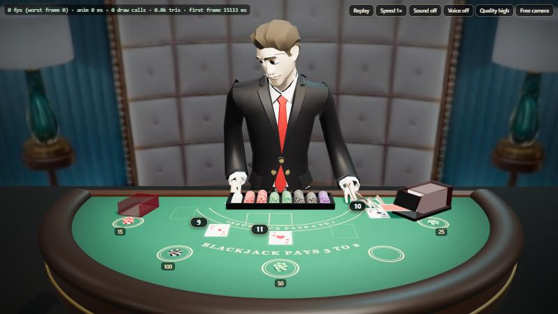
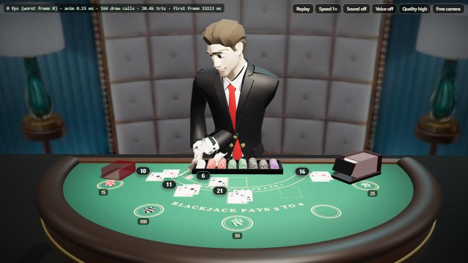
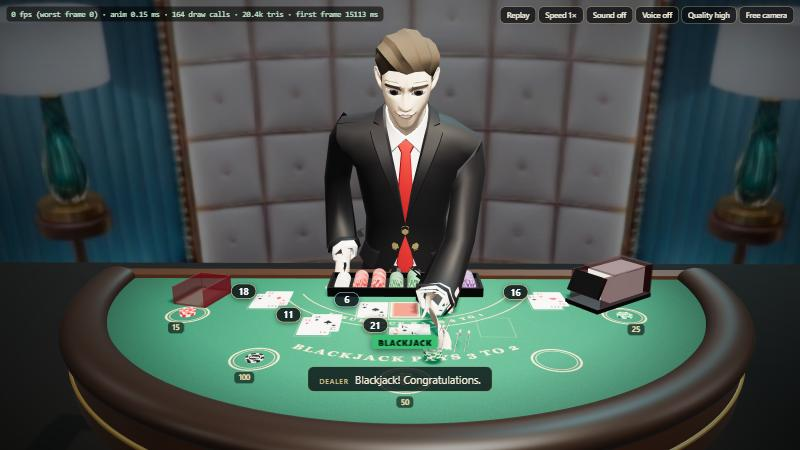
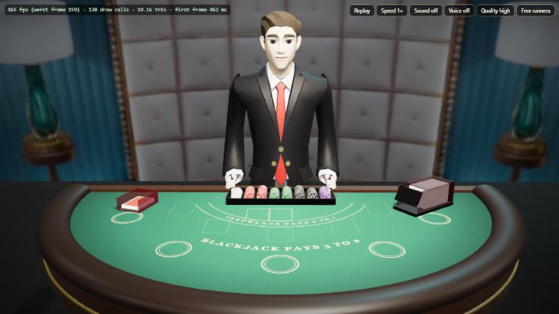

# Prototype verdict: real-time 3D live-dealer table

Branch `claude/dealer-3d-prototype-864766`, 15 Nov 2026. One working day of a two-day box.

## Verdict in one paragraph

**A premium *stylised* live table is achievable for free, in real time, in the browser. A
photoreal Evolution-style human dealer is not.** The table, cards, chips, shoe, camera,
lighting and sound are a solved problem: the prototype does all of them procedurally at
165 fps on this laptop's integrated GPU with a 0.76 MB download. The dealer is the only
hard part, and it is an *art* problem, not an engineering one. With the low-poly model
already in the repo the dealer reads as "decent mobile-game character", clearly not a
person. My recommendation is to commit to real-time 3D for everything on the table, keep
the dealer as a swappable layer, and upgrade the dealer model rather than switch to video.

## How to run it

```
cd frontend
npm install
npm run dev
```

Open **http://localhost:5173/prototype.html** (no backend needed). Click *Take a seat* for
sound, or add `?autoplay` to start muted. Buttons top right: replay, speed (0.4× is the
best way to judge the motion), sound, voice (browser text-to-speech), quality, free camera.
The 2D game at `/` is untouched; the prototype is a separate Vite entry and imports nothing
from it.

## Screenshots

| | |
|---|---|
|  Left hand draws from the shoe |  Reaching across: torso leans and twists |
|  Paying a blackjack from the tray |  Idle between rounds, looking at the player |

Phone portrait (works, badly framed): [docs/prototype/05-phone-portrait.jpg](docs/prototype/05-phone-portrait.jpg)

## 1. Audit of the existing 3D work

| File | Size | Tris | Rig / clips | Licence (from file metadata) | Usable? |
|---|---|---|---|---|---|
| `dealer_animated.glb` | 0.33 MB | 3.7k | 21 bones, 6 clips | derived from *Man In Suit* by jetsu, **CC-BY 4.0** | **Rig yes, clips no** |
| `man_in_suit.glb` | 0.2 MB | 3.7k | none | CC-BY 4.0 (jetsu) | Superseded by the rigged copy |
| `blackjack_table.glb` | 23.9 MB | 500k | none | CC-BY 4.0 (nermin) | No: 70× too heavy for one prop |
| `gameready_casino_scene.glb` | 32.2 MB | 393k | none | **Sketchfab Standard** | No: heavy, and not redistributable |
| `playing_cards.glb` | 85.2 MB | 3k | none | **"COPYRIGHT TO jdastine"** | No: 216 embedded textures, no usable licence |
| `dealer.blend` | 0.3 MB | | source of the rigged dealer | | Keep as source |

- The dealer rig is the one useful asset. Its six baked clips (Idle, Deal, Nod, PayWinner,
  Shuffle, TakeChips) are hand-keyed and unusable: arms barely leave the sides, and
  `PayWinner` swings the arm backwards. A baked "Deal" clip could never work anyway, because
  the hand has to land on a different spot for every card.
- The rig has no finger bones and no face bones or blendshapes, and the skin weights are
  rough. That caps how good this particular character can ever look.
- `Dealer3D.jsx`, `BlackjackTable3D.jsx`, `TableViewer.jsx` are leftovers from the abandoned
  attempt. I reused none of them. `HANDOVER.md` says 3D was dropped largely because the
  preview tool could not screenshot WebGL; that is no longer true, screenshots work.
- **Deployment problem found on the way:** `frontend/public/` holds 182 MB of these unused
  files and Vite copies all of it into `dist/` (184 MB). Two of them have licences that do
  not allow redistribution. Not fixed here, see follow-ups.

## 2. What the prototype is

`frontend/prototype.html` → `frontend/src/prototype/`:

| File | Role |
|---|---|
| `script.js` | The scripted round as an **ordered event list** (`round_start`, `card_dealt`, `player_action`, `hole_card_revealed`, `hand_paid`, `round_end`) |
| `director.js` | Plays events in order; one choreography routine per event type |
| `dealerRig.js` | Procedural dealer: two-bone arm IK, torso lean/twist, head look, breathing, blink |
| `props.js` | Cards, chips, felt, rail, shoe, tray, discard holder, all generated in code |
| `audio.js` | Synthesised card and chip sounds, optional browser speech |
| `timeline.js`, `layout.js`, `PrototypeApp.jsx` | Tween clock, table measurements, page and HUD |

The round has four seats and shows every case: a blackjack paid 3:2, a hit that busts
(chips and cards taken), a hit then stand that wins, a push, the hole-card flip, a dealer
draw, and the final sweep of all cards into the discard holder.

Two design decisions carry over to the real game regardless of which dealer you choose:

1. **The presentation only consumes events.** Replace `SCRIPTED_ROUND` with a socket stream
   and the same director plays live hands. The hole card has no identity until
   `hole_card_revealed`, so the server never has to leak it. This is exactly the contract
   `ROADMAP.md` Phase 6 asks the engine to emit.
2. **The prop drives, the hand follows.** A card always lands exactly on its spot; the hand
   tracks it as far as the arm reaches. Timing therefore never depends on the dealer
   animation, so the dealer can be swapped (better model, female model, even a video plate)
   without touching game logic.

No animation data is used at all. Every dealer movement is computed per frame from "where
should the fingertips be" and "what should the eyes look at".

## 3. Measurements

Production build (`vite build` + `vite preview`), this laptop, integrated **AMD Radeon
(Ryzen iGPU)** through ANGLE/D3D11, canvas 1600×900 at devicePixelRatio 1.25, shadows on.
Sampled every 0.5 s across one full 36 s round.

| Metric | Value |
|---|---|
| Frame rate | **165 fps average, 163 minimum** (165 is the display's refresh cap, so real headroom is higher) |
| Worst single frame | 15 ms (one hitch; probably a first-use texture upload) |
| Animation cost (IK + tweens) | **0.08 ms per frame** |
| Draw calls / triangles | up to 200 / 21k |
| Time to first rendered frame | **465 ms** on localhost, warm cache |
| Download | **0.76 MB**: JS 272 kB gzip + shared React chunk 60 kB gzip + dealer GLB 330 kB + backdrop 96 kB + CSS 1 kB |
| Uncompressed JS | 1.0 MB (three.js + R3F + drei); loaded only on the prototype page |

For comparison, one 30-second 720p dealer video is roughly 3–6 MB.

**Not measured:** no real phone was tested, and first-frame time over a real network was
not measured. Expect roughly 1.5–3 s to first frame on 4G, dominated by the JS download.

**Mobile concerns**
- Performance should be fine on mid-range phones at this scene weight; the budget risks are
  the 2048² shadow map and devicePixelRatio 3 screens. The *Quality low* switch (no shadows,
  DPR 1) exists for that. Draw calls (200) should be cut by instancing chips.
- **Portrait framing is poor.** The table fits but the dealer is small and a third of the
  screen is table pedestal. Portrait needs its own camera, closer and steeper.
- The score badges are HTML over the canvas; on small screens they crowd the cards.
- iOS Safari needs the tap-to-start for audio (already how the page works) and can evict
  WebGL contexts in background tabs; needs a context-lost handler.
- Animation freezes when the tab is hidden (browser behaviour). A live game must
  fast-forward to current state when the tab returns, not replay the queue.

## 4. What works, and what looks bad

**Works**
- The overall picture reads as a live-casino table: seated-player camera, studio backdrop
  (the owner's own `bg_teal` art), felt with printed arcs, tray, shoe, discard holder.
- Dealing is properly synced: hand goes to the shoe, the card comes out with it, turns
  face-up in flight and lands on the right spot. Far seats get a lean and a twist.
- Chips paid from the tray and collected to it; hole-card flip; card sweep at the end.
- Idle life: breathing, slow sway, blinking, eyes follow the card then return to the player.
- Sound made from nothing: card slide, snap, chip clicks, table knock.

**Looks bad (honest list)**
- **The dealer is the weak point.** Faceted low-poly body, mitten hands with no finger
  movement, no facial expression, no mouth movement when he "speaks". Shoulders and elbows
  crease because of the rough skin weights.
- The reach is solved by leaning, and the lean on cross-table deals is a stoop no real
  dealer does. Needs a seated/taller dealer, longer reach or a card "pitch" instead.
- Cards are not really gripped; the hand hovers over them. Hands sometimes clip the tray.
- Browser text-to-speech sounds robotic. Leave it off; use recorded lines.
- Shadows are slightly hard, there is no depth of field, and the flat backdrop gives no
  parallax beyond a tiny camera drift.
- Score badges are plain HTML chips floating over the canvas.
- ESLint's React-compiler rules flag the imperative three.js code (8 errors); not cleaned up.

## 5. Paths to "Evolution feel"

Effort is for one developer working with an AI assistant, starting from this branch.

| | A. Real-time stylised 3D | B. Pre-rendered video plates | C. Hybrid: video dealer + 3D cards/chips |
|---|---|---|---|
| What it is | This prototype with a much better character | Dealer is a library of short clips cut together; table drawn under it | Dealer upper body is video; everything on the felt is live 3D |
| Ceiling | High-end stylised game. Never photoreal | Photoreal if the clips are good | Photoreal dealer, crisp table |
| Sync with game | Exact, any speed, any seat | Poor: one clip per seat per action, fixed speed | Medium: gestures generic, cards animate on their own |
| Clips needed per dealer | 0 | 30–40 (deal ×6 targets, flip, pay ×5, take ×5, push, idles, reactions) | 8–12 (deal left/centre/right, flip, pay, take, idles) |
| Download | ~1–3 MB | 15–30 MB per dealer | 5–10 MB per dealer |
| Cost | Free (CC0 character generators) | **Paid generation credits**, many retries | Paid credits, fewer |
| Main risk | Character art quality | Clips do not return to the same pose, so every cut pops; character drifts between clips | Hand and card never quite line up; alpha video needs two encodes (WebM + HEVC for Safari) |
| Second dealer | 3–5 days | Full clip set again | Full clip set again |
| Effort to shippable | **3–4 weeks** | 4–6 weeks, uncertain | 2–3 weeks, uncertain |

### Recommendation

**Go with A, and spend the effort on the character.**

1. It is the only path proven end to end today, it costs nothing, and it is the only one
   where the dealer's hand actually goes where the card goes at any game speed.
2. The engineering is done-in-miniature. What remains is art: replace the 3.7k-triangle
   model with a proper stylised human that has fingers and a face rig. The free route is
   **MPFB2 (MakeHuman for Blender)**: CC0 output, male and female bodies, finger bones,
   facial shape keys, clothes. Because the animation is procedural, a new model needs only
   a bone-name map and it inherits every gesture.
3. B fights the game: blackjack has too many (seat × action) combinations for a clip
   library, and cuts between AI clips will pop. I would not pursue it.
4. C is the only route to a *photoreal* dealer, and it is the right experiment **only if
   the owner decides photoreal is a must and is willing to spend credits**. The prototype
   is already shaped for it: hide the 3D dealer, put a video plate behind the table, keep
   the director. A one-day test with three clips (idle, deal, flip) would settle it.

**Suggested next steps for path A (about 3–4 weeks)**
- Week 1: MPFB2 male dealer with fingers and face shapes; map bones; add finger curl on
  grip, smile and blink shape keys; seat the dealer so reach needs no stoop.
- Week 2: engine emits the event list (Phase 6 first bullet); director consumes the socket
  stream; catch-up when the tab was hidden; instanced chips; portrait camera.
- Week 3: recorded voice lines (about 10 per dealer) with simple mouth open/close; polish
  lighting (soft shadows, baked contact shadows), table themes.
- Week 4: female dealer (below), mobile testing on real phones, quality tiers.

### What a female dealer needs
- A second MPFB2 character (female body, the gold dress from `DEALER_ART_GUIDE.md`, long
  hair). Long hair needs either a stiff sculpted style or 3–4 spring bones.
- A bone-name map and nothing else for animation: arm lengths and shoulder positions are
  read from the skeleton at load.
- Her own voice lines and a slightly different idle (weight, sway amplitude).
- Estimate: 3–5 days once the male pipeline exists.

## 6. Follow-ups outside this task

- **Remove the unused GLBs from `frontend/public/`** (`blackjack_table.glb`,
  `gameready_casino_scene.glb`, `playing_cards.glb`, `man_in_suit.glb`, the 8 MB PNGs in
  `art/`): they add 180 MB to every build, and two carry licences that do not allow
  redistribution. Keep `dealer_animated.glb` and `dealer.blend`.
- The dealer model is CC-BY 4.0: credit "Man In Suit by jetsu (Sketchfab)" somewhere
  visible if it ships.
- `HANDOVER.md` still says the dealer will be generated stills and that WebGL cannot be
  screenshotted; both are out of date.
